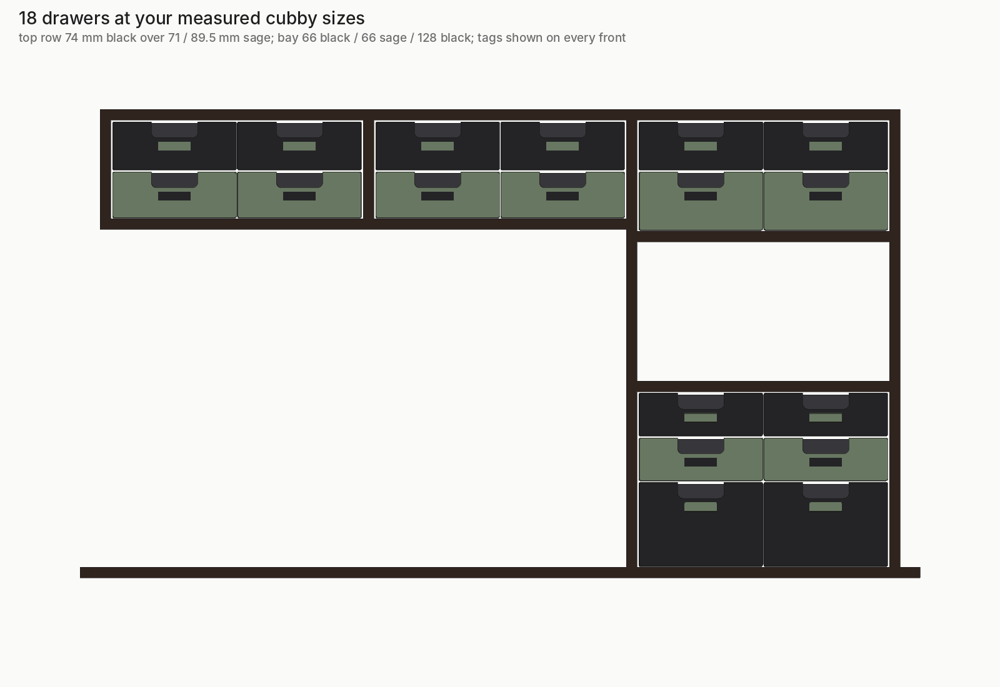
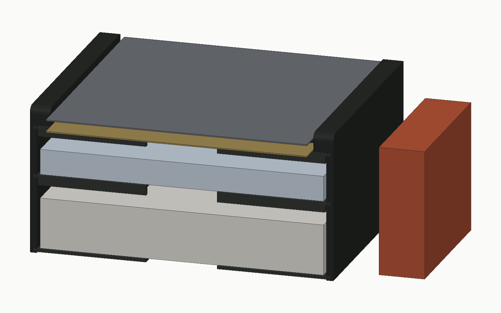

# Hutch drawers

A 3D-printable, modular drawer system for a desk hutch: 14 freestanding drawer modules
across two top cubbies and a lower bay, plus a paper and build-plate shelf in the top-left cubby, printed on a Bambu Lab A1 in black and sage PLA.

## What's here

| Folder | What it is |
|---|---|
| `projects/` | Ready-to-print **Bambu Studio projects** (.3mf). Parts are oriented and laid out on the plate, with the A1 0.4 mm profile, 0.2 mm layers, 3 walls, 15% infill, Textured PEI plate, and a brim on the tall parts already set. Open one, check the filament, slice, print. |
| `stl/` | The same parts as plain STL files, already in print orientation. |
| `source/` | The parametric model (Python + manifold3d) the parts are generated from, plus the script that builds the Bambu Studio projects. |
| `manifest.json` | Every project with Bambu Studio's own grams and print-time estimate. |

Every project in `projects/` was built and then re-opened and sliced with Bambu Studio 2.8.2 to check it.

## Printing

- **Frames** print standing on their back, long side front to back, with a 5 mm brim.
- **Drawers** print upright. **Faceplates** print face down (the bed side becomes the visible front).
- **Latches** print in tied rows (PETG). Snap the tie bars off with flush cutters.
- **TPU parts** use the Bambu TPU 95A HF profile from an external spool.

Opening a project from a link: `bambustudio://open?file=<raw file URL>` opens it straight in Bambu Studio.
The build tracker uses those links for its "Open in Bambu Studio" buttons.

## Projects

### Fit test

| Project | Material | Bambu estimate | File |
|---|---|---|---|
| Fit-test frame | PLA, black | 186 g · 3 h 21 | [fit_frame.3mf](https://raw.githubusercontent.com/Blank428/hutch-drawers/main/projects/fit-test/fit_frame.3mf) |
| Fit-test drawer | PLA, black | 130 g · 2 h 48 | [fit_drawer.3mf](https://raw.githubusercontent.com/Blank428/hutch-drawers/main/projects/fit-test/fit_drawer.3mf) |
| Fit-test faceplate, black | PLA, black | 34 g · 46 min | [fit_faceplate_black.3mf](https://raw.githubusercontent.com/Blank428/hutch-drawers/main/projects/fit-test/fit_faceplate_black.3mf) |
| Fit-test faceplate, sage | PLA, sage | 34 g · 46 min | [fit_faceplate_sage.3mf](https://raw.githubusercontent.com/Blank428/hutch-drawers/main/projects/fit-test/fit_faceplate_sage.3mf) |

### Stop latches

| Project | Material | Bambu estimate | File |
|---|---|---|---|
| Latch test row right | PETG | 6 g · 24 min | [latch_test_row_right.3mf](https://raw.githubusercontent.com/Blank428/hutch-drawers/main/projects/latches/latch_test_row_right.3mf) |
| Latch test row left | PETG | 6 g · 24 min | [latch_test_row_left.3mf](https://raw.githubusercontent.com/Blank428/hutch-drawers/main/projects/latches/latch_test_row_left.3mf) |
| Latch row right | PETG | 30 g · 1 h 45 | [latch_row_right.3mf](https://raw.githubusercontent.com/Blank428/hutch-drawers/main/projects/latches/latch_row_right.3mf) |
| Latch row left | PETG | 30 g · 1 h 48 | [latch_row_left.3mf](https://raw.githubusercontent.com/Blank428/hutch-drawers/main/projects/latches/latch_row_left.3mf) |
| Latch soft test row right | PETG | 6 g · 24 min | [latch_soft_test_row_right.3mf](https://raw.githubusercontent.com/Blank428/hutch-drawers/main/projects/latches/latch_soft_test_row_right.3mf) |
| Latch soft test row left | PETG | 6 g · 23 min | [latch_soft_test_row_left.3mf](https://raw.githubusercontent.com/Blank428/hutch-drawers/main/projects/latches/latch_soft_test_row_left.3mf) |
| Latch firm test row right | PETG | 6 g · 24 min | [latch_firm_test_row_right.3mf](https://raw.githubusercontent.com/Blank428/hutch-drawers/main/projects/latches/latch_firm_test_row_right.3mf) |
| Latch firm test row left | PETG | 6 g · 24 min | [latch_firm_test_row_left.3mf](https://raw.githubusercontent.com/Blank428/hutch-drawers/main/projects/latches/latch_firm_test_row_left.3mf) |

### 128 mm modules

| Project | Material | Bambu estimate | File |
|---|---|---|---|
| 128mm frame | PLA, black | 311 g · 7 h 03 | [frame_128mm.3mf](https://raw.githubusercontent.com/Blank428/hutch-drawers/main/projects/modules-128mm/frame_128mm.3mf) |
| 128mm drawer | PLA, black | 319 g · 6 h 08 | [drawer_128mm.3mf](https://raw.githubusercontent.com/Blank428/hutch-drawers/main/projects/modules-128mm/drawer_128mm.3mf) |
| 128mm faceplate, black, 1 per plate | PLA, black | 62 g · 1 h 16 | [faceplate_128mm_black_x1.3mf](https://raw.githubusercontent.com/Blank428/hutch-drawers/main/projects/modules-128mm/faceplate_128mm_black_x1.3mf) |

### 66 mm modules

| Project | Material | Bambu estimate | File |
|---|---|---|---|
| 66mm frame | PLA, black | 259 g · 5 h 59 | [frame_66mm.3mf](https://raw.githubusercontent.com/Blank428/hutch-drawers/main/projects/modules-66mm/frame_66mm.3mf) |
| 66mm drawer | PLA, black | 195 g · 3 h 58 | [drawer_66mm.3mf](https://raw.githubusercontent.com/Blank428/hutch-drawers/main/projects/modules-66mm/drawer_66mm.3mf) |
| 66mm faceplate, black, 1 per plate | PLA, black | 30 g · 41 min | [faceplate_66mm_black_x1.3mf](https://raw.githubusercontent.com/Blank428/hutch-drawers/main/projects/modules-66mm/faceplate_66mm_black_x1.3mf) |
| 66mm faceplate, black, 2 per plate | PLA, black | 60 g · 1 h 22 | [faceplate_66mm_black_x2.3mf](https://raw.githubusercontent.com/Blank428/hutch-drawers/main/projects/modules-66mm/faceplate_66mm_black_x2.3mf) |
| 66mm faceplate, sage, 1 per plate | PLA, sage | 30 g · 41 min | [faceplate_66mm_sage_x1.3mf](https://raw.githubusercontent.com/Blank428/hutch-drawers/main/projects/modules-66mm/faceplate_66mm_sage_x1.3mf) |
| 66mm faceplate, sage, 2 per plate | PLA, sage | 60 g · 1 h 22 | [faceplate_66mm_sage_x2.3mf](https://raw.githubusercontent.com/Blank428/hutch-drawers/main/projects/modules-66mm/faceplate_66mm_sage_x2.3mf) |

### 74 mm modules

| Project | Material | Bambu estimate | File |
|---|---|---|---|
| 74mm faceplate, black, 3 per plate | PLA, black | 103 g · 2 h 17 | [faceplate_74mm_black_x3.3mf](https://raw.githubusercontent.com/Blank428/hutch-drawers/main/projects/modules-74mm/faceplate_74mm_black_x3.3mf) |
| 74mm frame | PLA, black | 266 g · 6 h 07 | [frame_74mm.3mf](https://raw.githubusercontent.com/Blank428/hutch-drawers/main/projects/modules-74mm/frame_74mm.3mf) |
| 74mm drawer | PLA, black | 211 g · 4 h 14 | [drawer_74mm.3mf](https://raw.githubusercontent.com/Blank428/hutch-drawers/main/projects/modules-74mm/drawer_74mm.3mf) |
| 74mm faceplate, black, 1 per plate | PLA, black | 34 g · 46 min | [faceplate_74mm_black_x1.3mf](https://raw.githubusercontent.com/Blank428/hutch-drawers/main/projects/modules-74mm/faceplate_74mm_black_x1.3mf) |

### 71 mm modules

| Project | Material | Bambu estimate | File |
|---|---|---|---|
| 71mm frame | PLA, black | 263 g · 6 h 02 | [frame_71mm.3mf](https://raw.githubusercontent.com/Blank428/hutch-drawers/main/projects/modules-71mm/frame_71mm.3mf) |
| 71mm drawer | PLA, black | 205 g · 4 h 09 | [drawer_71mm.3mf](https://raw.githubusercontent.com/Blank428/hutch-drawers/main/projects/modules-71mm/drawer_71mm.3mf) |
| 71mm faceplate, sage, 1 per plate | PLA, sage | 33 g · 44 min | [faceplate_71mm_sage_x1.3mf](https://raw.githubusercontent.com/Blank428/hutch-drawers/main/projects/modules-71mm/faceplate_71mm_sage_x1.3mf) |
| 71mm faceplate, sage, 3 per plate | PLA, sage | 98 g · 2 h 12 | [faceplate_71mm_sage_x3.3mf](https://raw.githubusercontent.com/Blank428/hutch-drawers/main/projects/modules-71mm/faceplate_71mm_sage_x3.3mf) |

### 89.5 mm modules

| Project | Material | Bambu estimate | File |
|---|---|---|---|
| 89.5mm frame | PLA, black | 278 g · 6 h 33 | [frame_89-5mm.3mf](https://raw.githubusercontent.com/Blank428/hutch-drawers/main/projects/modules-89-5mm/frame_89-5mm.3mf) |
| 89.5mm drawer | PLA, black | 242 g · 4 h 48 | [drawer_89-5mm.3mf](https://raw.githubusercontent.com/Blank428/hutch-drawers/main/projects/modules-89-5mm/drawer_89-5mm.3mf) |
| 89.5mm faceplate, sage, 1 per plate | PLA, sage | 42 g · 54 min | [faceplate_89-5mm_sage_x1.3mf](https://raw.githubusercontent.com/Blank428/hutch-drawers/main/projects/modules-89-5mm/faceplate_89-5mm_sage_x1.3mf) |
| 89.5mm faceplate, sage, 2 per plate | PLA, sage | 84 g · 1 h 49 | [faceplate_89-5mm_sage_x2.3mf](https://raw.githubusercontent.com/Blank428/hutch-drawers/main/projects/modules-89-5mm/faceplate_89-5mm_sage_x2.3mf) |

### TPU parts

| Project | Material | Bambu estimate | File |
|---|---|---|---|
| Foot pads, 32 | TPU 95A | 3 g · 11 min | [foot_pads_x32.3mf](https://raw.githubusercontent.com/Blank428/hutch-drawers/main/projects/tpu/foot_pads_x32.3mf) |
| Top spacers 3.0 mm, 24 | TPU 95A | 7 g · 20 min | [top_spacers_3-0mm_x24.3mf](https://raw.githubusercontent.com/Blank428/hutch-drawers/main/projects/tpu/top_spacers_3-0mm_x24.3mf) |
| Top spacers 3.5 mm, 8 | TPU 95A | 3 g · 7 min | [top_spacers_3-5mm_x8.3mf](https://raw.githubusercontent.com/Blank428/hutch-drawers/main/projects/tpu/top_spacers_3-5mm_x8.3mf) |

### Paper shelf (top-left cubby)

The top-left cubby holds a freestanding shelf instead of drawers: printer paper (a full ream) on
the bottom, lined paper in the middle, and two build-plate slots on top. Two side panels with
sliding-dovetail grooves; each shelf prints as two halves that lock together with dovetail tabs,
then slides in from the front. No screws. Print the fit test first to check both joints.

| Project | Material | Bambu estimate | File |
|---|---|---|---|
| Fit test (panel slice + two shelf pieces) | PLA, black | 7 g · 14 min | [paper_shelf_fit_test.3mf](https://raw.githubusercontent.com/Blank428/hutch-drawers/main/projects/paper-shelf/paper_shelf_fit_test.3mf) |
| Side panels, 2 plates | PLA, black | 282 g · 5 h 17 | [paper_shelf_side_panels_x2.3mf](https://raw.githubusercontent.com/Blank428/hutch-drawers/main/projects/paper-shelf/paper_shelf_side_panels_x2.3mf) |
| Shelf halves, 6 plates | PLA, black | 514 g · 10 h 17 | [paper_shelf_shelf_halves_x6.3mf](https://raw.githubusercontent.com/Blank428/hutch-drawers/main/projects/paper-shelf/paper_shelf_shelf_halves_x6.3mf) |

## Assembly

1. Press a right and a left latch into the pockets at the back of each drawer's side walls.
2. Slide each faceplate down onto its drawer's two posts.
3. Push each drawer into its frame; the latch nubs click past the front edge.
4. Press 4 foot pads under each column's bottom module, stack the column on the desk, press 4 spacers onto the top module's bumps, and slide the column into its cubby.

## Mac helper

`helper/` is a small local helper for the build tracker. It keeps a copy of this repo on the Mac,
opens a project straight in Bambu Studio when you press "Open in Bambu Studio" in the tracker
(local files skip Bambu's "not from a trusted site" prompt), and builds label tag plates on demand:
one plate per front colour with the colour-change pause already set at 0.8 mm.

Install or update: `bash helper/install.sh` (runs at login via a LaunchAgent, listens on 127.0.0.1:47833 only).
